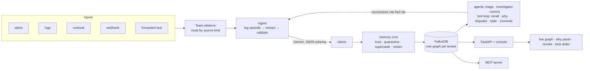
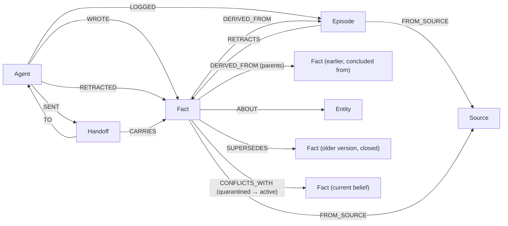

# MemLedger

**Shared memory for agent teams where every belief has a writer, a source, a validity window and a path, so you can retract a lie everywhere in one query.**

GraphHacks 2026 (WeMakeDevs × FalkorDB) · **Track 02: Agent Memory and Coordination**

- **Live demo:** TODO(you): Cloud Run URL (say which database mode it uses, see [Deployment](#deployment))
- **Demo video:** TODO(you): link
- **AI assistance:** most of the code was written with an AI assistant; see [AI_DISCLOSURE.md](AI_DISCLOSURE.md)

<!-- YOU: one paragraph in your own words: why you picked this problem and what you wanted to prove. Judges read this first. -->

---

## The problem

Multi-agent systems share memory as a blob: a chat history, a vector store, a key-value scratchpad. The last write wins. That breaks in exactly the ways incident response can't afford:

- an untrusted message overwrites a belief because it arrived later;
- a guess ("possibly the cause") becomes a fact;
- when a source turns out to be wrong, nobody can find everything that was built on it;
- nobody can say what the team believed at 13:55, or why.

## What MemLedger does

Agents (Triage, Investigator, Comms) share one memory graph in FalkorDB. Every fact records **who** wrote it, **which source** it came from, **which earlier facts** it was concluded from, **when** it was true, and **what it replaced**. On top of that:

| Capability | How |
|---|---|
| **Supersede, don't overwrite** | a new value closes the old fact (`valid_to`) and links `SUPERSEDES` |
| **Quarantine** | claims from untrusted sources, and hedged claims from any source, are stored but never handed to agents as beliefs; contradictions become visible **disputes** |
| **Revoke** | one variable-length Cypher traversal withdraws everything a compromised source said, and everything concluded from it, across agents |
| **Explain** | any fact's path back to its sources, writers and the values it replaced |
| **Time travel** | what the team believed at any moment |
| **Stale reasoning** | conclusions whose basis was replaced are flagged |
| **Tenancy** | one FalkorDB graph per customer; forgetting a customer is one `GRAPH.DELETE` |
| **Grounded extraction** | the LLM proposes claims; code keeps only those that quote their evidence verbatim |
| **MCP** | Claude Desktop or any MCP client reads the same memory with the same rules |

## Why the graph is necessary

Take FalkorDB out and these stop existing, not just get slower:

- **Revocation** is a traversal along `FROM_SOURCE` and `DERIVED_FROM` edges, up to 6 hops, across agents.
- **Provenance** ("why do we believe this?") is a path query.
- **Supersession and disputes** are edges between versions of a belief.
- **Handoffs** are nodes carrying fact ids, so a receiver sees if a handed-over fact was later revoked.
- **Tenant isolation and deletion** are separate graphs.

[Evaluation](#evaluation) shows what goes wrong without them.

---

## Architecture



## Graph data model



| Node | Key properties |
|---|---|
| `Agent` | `id`, `role` |
| `Source` | `id`, `kind`, `trust` (0–1), `compromised` |
| `Episode` | `id`, `session`, `at`, `text` (one logged turn) |
| `Entity` | `name` (the incident) |
| `Fact` | `id`, `subject`, `predicate`, `object`, `status` (active · quarantined · closed · revoked), `valid_from`, `valid_to`, `trust` |
| `Handoff` | `id`, `session`, `at`, `note`, `delivered` |

Predicates are a closed set: `root_cause`, `status`, `owner`, `severity` (one value at a time) and `affects_service`, `mitigation` (several).

---

## Run it locally

```bash
git clone TODO(you) && cd memledger
python -m venv .venv && source .venv/bin/activate
pip install -r requirements.txt pytest httpx "mcp==2.2.0"
# graph library for the console (MIT, vasturiano/force-graph)
mkdir -p memledger/static/vendor && curl -L \
  https://cdn.jsdelivr.net/npm/force-graph@1.47.4/dist/force-graph.min.js \
  -o memledger/static/vendor/force-graph.min.js
```

**No API key, no Docker** (reference extraction and rule-following stand-in agents, clearly labelled in the UI):

```bash
MEMLEDGER_EMBEDDED_DB=1 MEMLEDGER_EXTRACT=golden MEMLEDGER_AGENTS=offline python -m memledger.serve
# open http://localhost:8080 → Next step
```

**Real models with Docker FalkorDB:**

```bash
docker run -d -p 6379:6379 -p 3000:3000 falkordb/falkordb:latest
export GEMINI_API_KEY=...
MEMLEDGER_EXTRACT=cache MEMLEDGER_AGENTS=live python -m memledger.serve
```

**Terminal demo, tests, evaluation:**

```bash
python scripts/demo.py --extract golden --agents offline --reset --all
pytest -q
python scripts/eval.py --embedded --extract golden --agents offline
```

---

## The demo story

INC-42, a payments-api latency spike, across two sessions:
- session 1 blames the DB pool;
- session 2 corrects it to a bad deploy and rules out the pool-size fix;
- a forwarded message claims a DDoS and tries a prompt injection;
- a trusted cache integration recommends flushing the cache, then turns out to be compromised and is revoked.

A second customer (globex) shows isolation. `data/acme/scenario.json` has all 15 steps.

---

## Evaluation

The same stream of extracted claims, replayed into four memory designs, with 16 questions asked at checkpoints during the story. Answers come from deterministic readers, so this measures memory policy, not model phrasing.

**This is a scorecard, not a benchmark:** the scenario, questions and baselines were designed by us around MemLedger's features.

TODO(you): paste the table from `python scripts/eval.py ... --out data/acme/eval_results` (and say which mode). Rehearsal-mode result:

| System | Score |
|---|---|
| No shared memory | 4/16 |
| Shared log, last write wins | 5/16 |
| Shared log + trust filter + delete on revoke | 8/16 |
| **MemLedger** | **15/16** |

The miss (Q16) is a time-travel bug the evaluation found; TODO(you): update after applying the fix.

---

## Concurrency and tenancy

- **Tenants** are separate FalkorDB graphs; isolation is tested at every layer, including under load.
- **Benchmark** (`scripts/bench.py`, embedded FalkorDB 4.18.3, one machine): 20 readers and parallel writers across 4 tenants gave 0 errors, no leaks, and the one-value-per-field invariant held. TODO(you): rerun against your deployed FalkorDB and paste.
- **Known limit:** writes to one tenant from several processes can race; the deployment runs one instance. A fix that holds the lock in FalkorDB is tested (TEN.md §5).

---

## Cypher queries

<!-- QUERIES:START -->
All 36 queries the product runs, generated from `memledger/queries.py`.

#### `INDEXES`

Run once per tenant graph. Re-running raises "already indexed"; ignore it.

```cypher
CREATE INDEX FOR (f:Fact) ON (f.id)
CREATE INDEX FOR (f:Fact) ON (f.subject, f.predicate, f.status)
CREATE INDEX FOR (s:Source) ON (s.id)
CREATE INDEX FOR (a:Agent) ON (a.id)
CREATE INDEX FOR (e:Entity) ON (e.name)
CREATE INDEX FOR (ep:Episode) ON (ep.id)
CREATE INDEX FOR (ep:Episode) ON (ep.session)
CREATE FULLTEXT INDEX FOR (ep:Episode) ON (ep.text)
```

#### `SEED`

Seed the tenant's agents and sources. Idempotent.

```cypher
UNWIND $agents AS a MERGE (x:Agent {id:a.id}) SET x.role = a.role
WITH count(*) AS _
UNWIND $sources AS s MERGE (y:Source {id:s.id})
ON CREATE SET y.kind = s.kind, y.trust = s.trust, y.compromised = false
```

#### `LOG_EPISODE`

Store one agent turn as an Episode (persistent conversation history).

```cypher
MATCH (a:Agent {id:$agent}), (src:Source {id:$source})
CREATE (ep:Episode {id:$id, session:$session, at:$now, text:$text})
CREATE (a)-[:LOGGED {at:$now}]->(ep)
CREATE (ep)-[:FROM_SOURCE]->(src)
RETURN ep.id AS id
```

#### `WRITE_FACT`

Create a Fact with full provenance. For single-valued predicates ($single = true): an active new fact closes every active fact with the same subject+predicate and a different object (SUPERSEDES); a quarantined new fact only records CONFLICTS_WITH against them. Multi-valued facts never conflict.

```cypher
MATCH (a:Agent {id:$agent}), (src:Source {id:$source}), (ep:Episode {id:$episode})
MERGE (e:Entity {name:$subject})
CREATE (f:Fact {id:$id, subject:$subject, predicate:$predicate, object:$object,
                valid_from:$now, status:$status, trust:src.trust})
CREATE (a)-[:WROTE {at:$now}]->(f)
CREATE (f)-[:FROM_SOURCE]->(src)
CREATE (f)-[:DERIVED_FROM]->(ep)
CREATE (f)-[:ABOUT]->(e)
WITH f
OPTIONAL MATCH (old:Fact {subject:$subject, predicate:$predicate, status:'active'})
WHERE $single AND old.id <> f.id AND old.object <> $object
FOREACH (o IN CASE WHEN old IS NULL OR $status <> 'active' THEN [] ELSE [old] END |
  SET o.status = 'closed', o.valid_to = $now
  CREATE (f)-[:SUPERSEDES]->(o))
FOREACH (o IN CASE WHEN old IS NULL OR $status <> 'quarantined' THEN [] ELSE [old] END |
  CREATE (f)-[:CONFLICTS_WITH {at:$now}]->(o))
WITH f, count(old) AS n
RETURN f.id AS id,
       CASE WHEN $status = 'active' THEN n ELSE 0 END AS closed,
       CASE WHEN $status = 'quarantined' THEN n ELSE 0 END AS conflicts
```

#### `LINK_PARENTS`

Record that a fact was concluded from earlier facts. Revocation follows these.

```cypher
MATCH (f:Fact {id:$id})
UNWIND $parents AS pid
MATCH (p:Fact {id:pid})
CREATE (f)-[:DERIVED_FROM]->(p)
RETURN count(p) AS linked
```

#### `CORROBORATE`

Another agent or source asserts a triple that already exists: add provenance, create no new Fact.

```cypher
MATCH (f:Fact {id:$id}), (src:Source {id:$source}), (a:Agent {id:$agent})
MERGE (f)-[:FROM_SOURCE]->(src)
CREATE (a)-[:WROTE {at:$now, corroborates:true}]->(f)
RETURN f.id AS id
```

#### `PROMOTE`

Move a quarantined fact to active and, for single-valued predicates, supersede whatever it contradicts.

```cypher
MATCH (q:Fact {id:$id, status:'quarantined'})
SET q.status = 'active', q.promoted_at = $now
WITH q
OPTIONAL MATCH (old:Fact {subject:q.subject, predicate:q.predicate, status:'active'})
WHERE q.predicate IN $single_preds AND old.id <> q.id AND old.object <> q.object
FOREACH (o IN CASE WHEN old IS NULL THEN [] ELSE [old] END |
  SET o.status = 'closed', o.valid_to = $now
  CREATE (q)-[:SUPERSEDES]->(o))
RETURN q.id AS id, count(old) AS closed
```

#### `RETRACT`

Explicit retraction ("ruled out X"): close the matching active fact without a replacement and record who retracted it, from which episode.

```cypher
MATCH (f:Fact {subject:$subject, predicate:$predicate, object:$object, status:'active'})
MATCH (a:Agent {id:$agent}), (ep:Episode {id:$episode})
SET f.status = 'closed', f.valid_to = $now, f.retracted = true
CREATE (a)-[:RETRACTED {at:$now}]->(f)
CREATE (ep)-[:RETRACTS]->(f)
RETURN f.id AS id
```

#### `REVOKE`

Blast-radius revocation. Mark the source compromised, then revoke every live fact that reaches it through FROM_SOURCE / DERIVED_FROM within 6 hops.

```cypher
MATCH (s:Source {id:$source})
SET s.compromised = true
WITH s
MATCH (s)<-[:FROM_SOURCE|DERIVED_FROM*1..6]-(f:Fact)
WHERE f.status IN ['active','quarantined']
WITH DISTINCT f
SET f.revoked_from = f.status, f.status = 'revoked', f.valid_to = $now
WITH f
OPTIONAL MATCH (a:Agent)-[w:WROTE]->(f)
WHERE w.corroborates IS NULL
RETURN f.id AS id, f.subject AS subject, f.predicate AS predicate,
       f.object AS object, a.id AS writer
```

#### `SOURCE_INFO`

Trust and compromise flag for one source.

```cypher
MATCH (s:Source {id:$id})
RETURN s.trust AS trust, s.compromised AS compromised
```

#### `FIND_SAME`

Facts with this exact triple that are still live.

```cypher
MATCH (f:Fact {subject:$subject, predicate:$predicate, object:$object})
WHERE f.status IN ['active','quarantined']
RETURN f.id AS id, f.status AS status
```

#### `PARENT_STATUS`

Status, subject and predicate of the facts a new fact is derived from.

```cypher
UNWIND $ids AS pid
OPTIONAL MATCH (p:Fact {id:pid})
RETURN pid AS id, p.status AS status, p.subject AS subject, p.predicate AS predicate
```

#### `KNOWN_VALUES`

Values already used for a subject, per predicate (revoked values excluded). Fed to the extractor so it reuses existing spellings.

```cypher
MATCH (f:Fact {subject:$subject})
WHERE f.status <> 'revoked'
RETURN f.predicate AS predicate, collect(DISTINCT f.object) AS values
```

#### `DISPUTES`

Quarantined claims that contradict a current belief.

```cypher
MATCH (q:Fact {status:'quarantined'})-[:CONFLICTS_WITH]->(a:Fact {status:'active'})
RETURN q.id AS id, q.subject AS subject, q.predicate AS predicate,
       q.object AS claimed, a.id AS against, a.object AS believed
ORDER BY q.valid_from
```

#### `READ_ACTIVE`

Current beliefs about one entity. The only read path agents use.

```cypher
MATCH (f:Fact {status:'active'})-[:ABOUT]->(e:Entity {name:$entity})
OPTIONAL MATCH (a:Agent)-[w:WROTE]->(f)
WHERE w.corroborates IS NULL
RETURN f.id AS id, f.predicate AS predicate, f.object AS object,
       f.valid_from AS since, a.id AS writer
ORDER BY f.valid_from DESC
```

#### `ALL_ACTIVE`

Every current belief in the tenant (Comms uses this for status updates).

```cypher
MATCH (f:Fact {status:'active'})
RETURN f.id AS id, f.subject AS subject, f.predicate AS predicate,
       f.object AS object, f.valid_from AS since
ORDER BY f.subject, f.predicate
```

#### `AS_OF`

What the team believed at time $t. Closed and revoked facts appear if they were valid then. Quarantined facts never appear.

```cypher
MATCH (f:Fact)
WHERE coalesce(f.promoted_at, f.valid_from) <= $t
  AND (f.valid_to IS NULL OR f.valid_to > $t)
  AND f.status <> 'quarantined'
  AND coalesce(f.revoked_from, 'active') <> 'quarantined'
RETURN f.id AS id, f.subject AS subject, f.predicate AS predicate, f.object AS object
ORDER BY f.subject, f.predicate
```

#### `FACT_VERSIONS`

Every version of one subject+predicate, oldest first (the supersession chain).

```cypher
MATCH (f:Fact {subject:$subject, predicate:$predicate})
RETURN f.id AS id, f.object AS object, f.status AS status,
       f.valid_from AS valid_from, f.valid_to AS valid_to
ORDER BY f.valid_from
```

#### `WHY`

Why is this believed? Writer, sources, everything upstream, values replaced.

```cypher
MATCH (f:Fact {id:$id})
OPTIONAL MATCH (a:Agent)-[w:WROTE]->(f)
OPTIONAL MATCH (f)-[:FROM_SOURCE]->(s:Source)
OPTIONAL MATCH (f)-[:DERIVED_FROM*1..6]->(up)
OPTIONAL MATCH (f)-[:SUPERSEDES]->(old:Fact)
RETURN f.id AS id, f.subject AS subject, f.predicate AS predicate,
       f.object AS object, f.status AS status,
       collect(DISTINCT a.id) AS agents,
       collect(DISTINCT s.id) AS sources,
       collect(DISTINCT up.id) AS upstream,
       collect(DISTINCT old.object) AS replaced
```

#### `WHY_PATHS`

Each path from a fact to a source behind it, as node-id lists (UI highlighting).

```cypher
MATCH p = (f:Fact {id:$id})-[:FROM_SOURCE|DERIVED_FROM*1..6]->(s:Source)
RETURN [n IN nodes(p) | coalesce(n.id, n.name)] AS path
```

#### `STALE`

Active facts built on a belief that has since been closed (stale reasoning).

```cypher
MATCH (f:Fact {status:'active'})-[:DERIVED_FROM*1..6]->(p:Fact {status:'closed'})
OPTIONAL MATCH (p)<-[:SUPERSEDES]-(n:Fact)
RETURN DISTINCT f.id AS id, f.predicate AS predicate, f.object AS object,
       p.id AS based_on, p.object AS based_on_value, n.object AS now_believed
```

#### `HISTORY`

Conversation history for one session.

```cypher
MATCH (a:Agent)-[:LOGGED]->(ep:Episode {session:$session})
RETURN ep.id AS id, a.id AS agent, ep.at AS at, ep.text AS text
ORDER BY ep.at
```

#### `NODES`

Whole graph for the UI (demo-sized graphs only).

```cypher
MATCH (n)
RETURN ID(n) AS nid, labels(n)[0] AS label, properties(n) AS props
```

#### `EDGES`


```cypher
MATCH (a)-[r]->(b)
RETURN ID(a) AS src, type(r) AS type, ID(b) AS dst
```

#### `TRUST_TABLE`

Every source with its trust and how many facts cite it directly, by status.

```cypher
MATCH (s:Source)
OPTIONAL MATCH (s)<-[:FROM_SOURCE]-(f:Fact)
RETURN s.id AS id, s.kind AS kind, s.trust AS trust, s.compromised AS compromised,
       sum(CASE WHEN f.status = 'active' THEN 1 ELSE 0 END) AS active,
       sum(CASE WHEN f.status = 'quarantined' THEN 1 ELSE 0 END) AS quarantined,
       sum(CASE WHEN f.status = 'revoked' THEN 1 ELSE 0 END) AS revoked
ORDER BY s.trust DESC, s.id
```

#### `BLAST_RADIUS`

Dry run of REVOKE: the same traversal, read-only. `direct` is true when the source itself asserted the fact; false when the fact was concluded from one that did. `hops` is the shortest provenance distance.

```cypher
MATCH p = (s:Source {id:$source})<-[:FROM_SOURCE|DERIVED_FROM*1..6]-(f:Fact)
WHERE f.status IN ['active','quarantined']
WITH s, f, min(length(p)) AS hops
OPTIONAL MATCH (f)-[d:FROM_SOURCE]->(s)
WITH f, hops, count(d) > 0 AS direct
OPTIONAL MATCH (a:Agent)-[w:WROTE]->(f)
WHERE w.corroborates IS NULL
RETURN f.id AS id, f.subject AS subject, f.predicate AS predicate,
       f.object AS object, f.status AS status, a.id AS writer, hops, direct
ORDER BY hops, f.valid_from
```

#### `SET_TRUST`

Change a source's trust. Affects future writes only.

```cypher
MATCH (s:Source {id:$id})
SET s.trust = $trust
RETURN s.id AS id, s.trust AS trust
```

#### `QUARANTINE`

Quarantined facts, newest first, with the source that put them there.

```cypher
MATCH (f:Fact {status:'quarantined'})-[:FROM_SOURCE]->(s:Source)
OPTIONAL MATCH (a:Agent)-[w:WROTE]->(f)
WHERE w.corroborates IS NULL
RETURN f.id AS id, f.subject AS subject, f.predicate AS predicate, f.object AS object,
       f.valid_from AS since, collect(DISTINCT s.id) AS sources, a.id AS writer
ORDER BY f.valid_from DESC
```

#### `ENSURE_SOURCE`

Create a source only if it doesn't exist. Never touches an existing source, so it cannot un-compromise one.

```cypher
MERGE (s:Source {id:$id})
ON CREATE SET s.kind = $kind, s.trust = $trust, s.compromised = false
RETURN s.id AS id, s.trust AS trust, s.compromised AS compromised
```

#### `HANDOFF`

Record a handoff between agents carrying fact ids (shared state, not text).

```cypher
MATCH (a:Agent {id:$from}), (b:Agent {id:$to})
CREATE (h:Handoff {id:$id, session:$session, at:$now, note:$note, delivered:false})
CREATE (a)-[:SENT]->(h)
CREATE (h)-[:TO]->(b)
WITH h
OPTIONAL MATCH (f:Fact) WHERE f.id IN $facts
FOREACH (x IN CASE WHEN f IS NULL THEN [] ELSE [f] END | CREATE (h)-[:CARRIES]->(x))
RETURN h.id AS id, count(f) AS facts
```

#### `SOURCE_KIND`

The kind of a source, used by Team.route to pick the agent that handles it.

```cypher
MATCH (s:Source {id:$id}) RETURN s.kind AS kind
```

#### `PENDING_HANDOFFS`

Handoffs waiting for an agent, oldest first, with the current status of each carried fact (a fact may have been revoked since it was handed over).

```cypher
MATCH (a:Agent)-[:SENT]->(h:Handoff {delivered:false})-[:TO]->(:Agent {id:$to})
OPTIONAL MATCH (h)-[:CARRIES]->(f:Fact)
RETURN h.id AS id, a.id AS sender, h.note AS note, h.at AS at, h.session AS session,
       collect({id:f.id, predicate:f.predicate, object:f.object, status:f.status}) AS facts
ORDER BY h.at
```

#### `DELIVER_HANDOFFS`

Mark handoffs as read.

```cypher
MATCH (h:Handoff) WHERE h.id IN $ids
SET h.delivered = true, h.delivered_at = $now
RETURN count(h) AS delivered
```

#### `LABEL_COUNTS`

Node counts by label.

```cypher
MATCH (n) RETURN labels(n)[0] AS label, count(n) AS n ORDER BY label
```

#### `FACT_STATUS_COUNTS`

Fact counts by status.

```cypher
MATCH (f:Fact) RETURN f.status AS status, count(f) AS n ORDER BY status
```

#### `I1_VIOLATIONS`

Single-valued (subject, predicate) pairs with more than one active fact. Must always be empty (Mem.md invariant I1); used to check it under load.

```cypher
MATCH (f:Fact {status:'active'})
WHERE f.predicate IN $single_preds
WITH f.subject AS subject, f.predicate AS predicate, collect(f.object) AS objects
WHERE size(objects) > 1
RETURN subject, predicate, objects
```

<!-- QUERIES:END -->

---

## Deployment

TODO(you): which mode the live URL uses.
- **Embedded** = FalkorDB inside the container: never expires, data resets on restart.
- **FalkorDB Cloud** = free tier: stops after a day unused.

See `DEP.md`.

## Limitations

- Extraction quality caps everything; the prompt was tuned on one scenario.
- One incident per episode; predicates are a closed set.
- No authentication on the API or console.
- Validity windows on one timeline, not full bi-temporal modelling.
- Evaluation is author-designed (above).

## Credits

[FalkorDB](https://www.falkordb.com/) and falkordblite · [force-graph](https://github.com/vasturiano/force-graph) (MIT) · FastAPI · Google Gemini · Model Context Protocol SDK.
